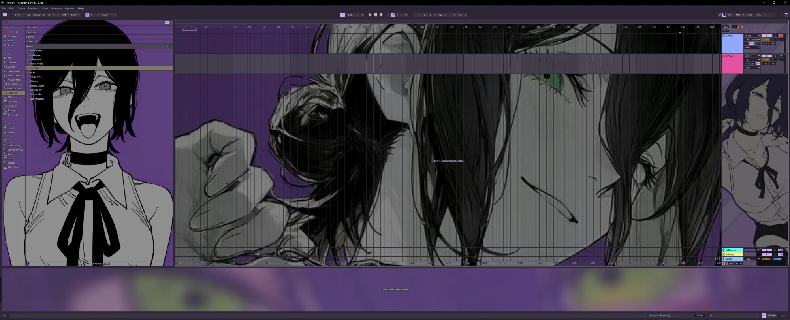
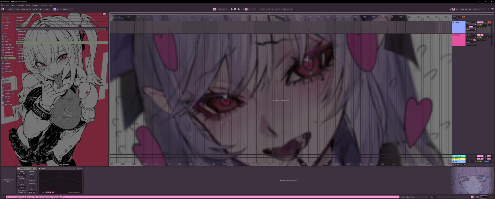
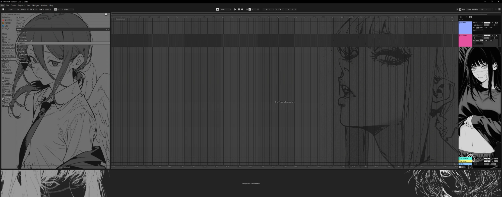
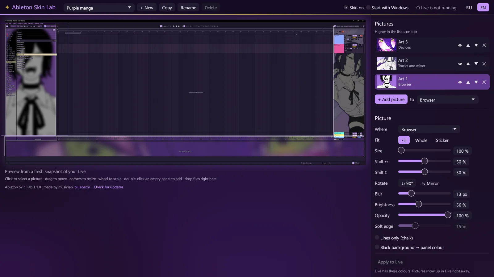

<div align="center">


# Ableton Skin Lab

**Your own pictures inside Ableton Live: art behind the browser, the arrangement and the mixer,<br>and interface colours picked from the picture.**

### [⬇ Download AbletonSkinLab.exe](https://github.com/Maximus657/ableton-skin-lab/releases/latest/download/AbletonSkinLab.exe)

[](https://github.com/Maximus657/ableton-skin-lab/releases/latest)


[](LICENSE)

**English** · [Русский](README.ru.md)

</div>



## What it does

- **A picture for every panel.** One picture behind the browser, another behind the arrangement, a third behind the devices, or one over the whole window. A picture can fill its panel, show whole, or sit anywhere as a sticker.
- **Live stays usable.** Pictures show only where Live has an empty panel background, so clips, the grid, knobs and text stay on top and everything stays clickable. A dark rim keeps the text readable even over a light picture.
- **Colours from the picture.** Add a picture and the interface takes its palette: the greys get its hue, the accents its brightest colours. Or set the hue, the accents, how dark and how colourful by hand.
- **See it first.** The editor shows your own Live window with the skin on it. Drag pictures with the mouse, resize them by the corners or with the wheel, blur, dim, rotate and mirror them.
- **Line art and dark art.** *Lines only* turns a drawing on white paper into light chalk lines; *Black background → panel colour* melts a dark picture into Live's panels.
- **As many skins as you like**, switched in the editor or from the tray.
- **Updates itself** from this page, and speaks **English and Russian**.

| | |
|:-:|:-:|
|  |  |


<p align="center"><sub>The editor: the pictures and their settings on the right, a preview of your Live on the left.</sub></p>

## Getting started

1. Download [**AbletonSkinLab.exe**](https://github.com/Maximus657/ableton-skin-lab/releases/latest/download/AbletonSkinLab.exe). It is a single file with no installer: put it in any folder (say `Documents\Ableton Skin Lab`) and run it.
2. Windows may say *“Windows protected your PC”*, because the exe is not code-signed. Click **More info → Run anyway**.
3. Open Ableton Live, and in the editor:
   - add pictures with **+ Add picture**, by dropping files onto the window, or by double-clicking a panel in the preview;
   - choose a panel and a fit for each picture, then move and resize it right in the preview;
   - when you like the colours, press **Apply to Live**.

Pictures show up in Live straight away. New interface colours wait for **Apply to Live**: to switch its theme, Live comes to the front with its Settings for a moment.

The skin stays on after you close the editor: a small part of Ableton Skin Lab lives in the tray and starts with Windows (untick **Start with Windows** if you don't want that). Untick **Skin on**, in the editor or in the tray menu, and Live goes back to its own theme.

## Updates

When the editor starts, it looks here for a newer release. If there is one, an **⬆ Update** button appears at the top: it downloads the new version, puts it in place of the old exe and restarts. **Check for updates** at the bottom of the editor does the same on demand, and so does `AbletonSkinLab.exe --update`.

## How it works

Ableton Live has no API for its interface, so Ableton Skin Lab works beside Live rather than inside it:

- **Colours.** A Live theme is an `.ask` file of about 240 colours, with no pictures. Ableton Skin Lab writes the skin's colours into a theme of its own (`Skin Lab A.ask` and `Skin Lab B.ask` in Live's `Resources\Themes` folder) and selects it in Live's Settings through Windows UI Automation.
- **Pictures.** A transparent window that lets clicks through floats above Live and follows it. It captures Live's window with Windows Graphics Capture and, on the GPU, shows the pictures wherever Live draws the theme's empty panel background. Everything Live draws over that background stays in front.
- **Panels.** The browser, the arrangement, the devices and the help panel are found through UI Automation, so the pictures keep their places when you resize the panels or the window.

Nothing is injected into Live, and none of its files change apart from those two theme files.

## Good to know

- Tested on Windows 11 with Ableton Live 12.4 Suite in English. On older Windows 10 builds, Windows may draw a thin yellow frame around Live while the skin is on.
- Settings, copies of your pictures and a log are in `%APPDATA%\SkinLab`. The pictures are copied there, so a skin survives the originals being moved.
- A recording or screenshot of the whole screen shows the pictures; capturing only Live's window does not.
- To uninstall: untick **Skin on** (Live gets its own theme back), choose **Exit** in the tray menu, untick **Start with Windows**, then delete the exe and `%APPDATA%\SkinLab`.

<details>
<summary><b>Command line</b></summary>

| Command | What it does |
|---|---|
| `AbletonSkinLab.exe` | the editor; starts the background part if it is not running |
| `AbletonSkinLab.exe --background` | only the background part: tray icon, pictures over Live |
| `AbletonSkinLab.exe --update` | installs the newest release, if it is newer than this one |
| `AbletonSkinLab.exe --new-skin "Name" picture.png` | makes a skin from one picture and switches to it |

</details>

<details>
<summary><b>Building from source</b></summary>

You need [Rust](https://rustup.rs) (stable, MSVC toolchain) and the Windows 10/11 SDK, which provides the resource compiler for the icon.

```bash
cd app
cargo build --release
```

The exe appears at `app/target/release/AbletonSkinLab.exe`.

</details>

## Author

Made by musician **blueberry**: [YouTube @blueberry.4677](https://www.youtube.com/@blueberry.4677).

The artwork in the screenshots belongs to its artists and is not part of the app: Ableton Skin Lab comes with no pictures, you bring your own.

Not affiliated with or endorsed by Ableton AG. Ableton and Live are trademarks of Ableton AG.

## License

[MIT](LICENSE)
