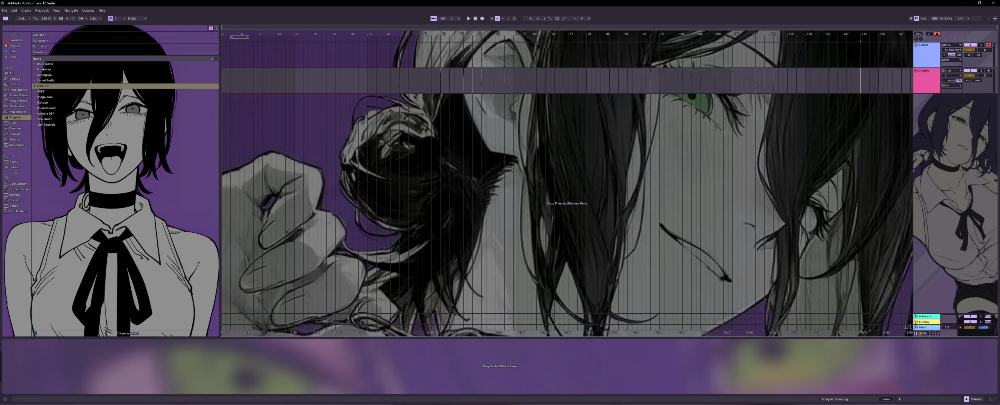
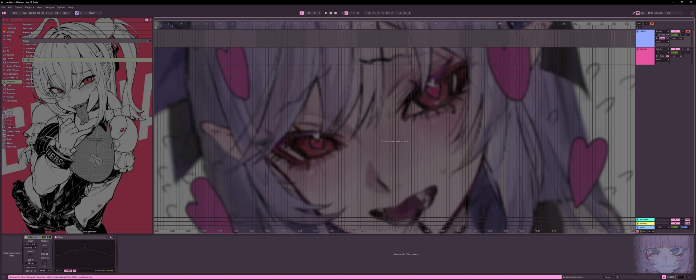
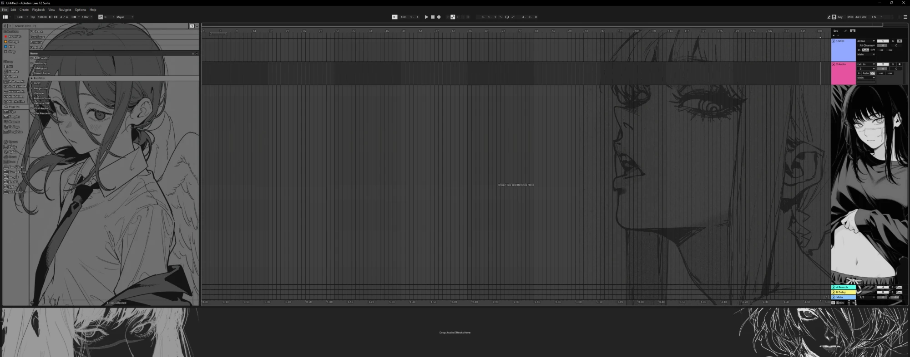
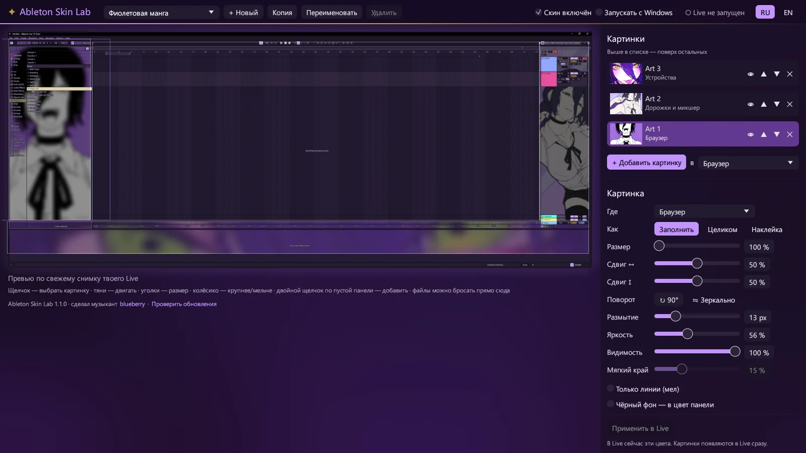

<div align="center">


# Ableton Skin Lab

**Свои картинки прямо в Ableton Live: арт за браузером, аранжировкой и микшером,<br>а цвета интерфейса — по картинке.**

### [⬇ Скачать AbletonSkinLab.exe](https://github.com/Maximus657/ableton-skin-lab/releases/latest/download/AbletonSkinLab.exe)

[](https://github.com/Maximus657/ableton-skin-lab/releases/latest)


[](LICENSE)

[English](README.md) · **Русский**

</div>



## Что умеет

- **Своя картинка в каждой панели.** Одна за браузером, другая за аранжировкой, третья за устройствами — или одна на всё окно. Картинка может заполнить панель, встать целиком или висеть где угодно наклейкой.
- **Live остаётся рабочим.** Картинки видны только там, где у Live пустой фон панели: клипы, сетка, ручки и текст остаются сверху, и всё нажимается как обычно. Тёмная кайма вокруг текста не даёт ему потеряться даже на светлой картинке.
- **Цвета по картинке.** Добавь картинку — и интерфейс возьмёт её палитру: серые получат её оттенок, акценты — самые яркие её цвета. Или выстави оттенок, акценты, «темнее» и «цветность» вручную.
- **Сначала посмотреть.** Редактор показывает твоё же окно Live со скином. Картинки двигаются мышью, меняют размер за уголки и колёсиком, размываются, притемняются, поворачиваются и отражаются.
- **Лайн-арт и тёмный арт.** «Только линии (мел)» превращает рисунок на белой бумаге в светлые линии, «Чёрный фон — в цвет панели» растворяет тёмную картинку в панелях Live.
- **Сколько угодно скинов**: переключаются в редакторе или из трея.
- **Обновляется сам** с этой страницы и говорит **по-русски и по-английски**.

| | |
|:-:|:-:|
|  |  |


<p align="center"><sub>Редактор: справа картинки и их настройки, слева превью твоего Live.</sub></p>

## Как начать

1. Скачай [**AbletonSkinLab.exe**](https://github.com/Maximus657/ableton-skin-lab/releases/latest/download/AbletonSkinLab.exe). Это один файл без установщика: положи его в любую папку (например, `Документы\Ableton Skin Lab`) и запусти.
2. Windows может написать «Система Windows защитила ваш компьютер» — у exe нет цифровой подписи. Нажми **Подробнее → Выполнить в любом случае**.
3. Открой Ableton Live, а в редакторе:
   - добавь картинки кнопкой **+ Добавить картинку**, перетаскиванием файлов в окно или двойным щелчком по панели на превью;
   - для каждой картинки выбери панель и вид, двигай и меняй размер прямо на превью;
   - когда цвета нравятся, нажми **Применить в Live**.

Картинки появляются в Live сразу. Новые цвета интерфейса ждут кнопки **Применить в Live**: чтобы сменить тему, Live на миг выходит вперёд со своими настройками.

Скин работает и после того, как закроешь редактор: маленькая часть Ableton Skin Lab живёт в трее и запускается вместе с Windows (сними **Запускать с Windows**, если не надо). Сними **Скин включён** — в редакторе или в меню трея — и Live вернётся к своей теме.

## Обновления

При запуске редактор проверяет, нет ли здесь новой версии. Если есть, вверху появляется кнопка **⬆ Обновление**: она скачает новую версию, поставит её вместо старого exe и перезапустит программу. То же самое по запросу — **Проверить обновления** внизу редактора — или `AbletonSkinLab.exe --update`.

## Как это устроено

У Ableton Live нет API для интерфейса, поэтому Ableton Skin Lab работает рядом с Live, а не внутри него:

- **Цвета.** Тема Live — это файл `.ask` примерно из 240 цветов, картинок в нём нет. Ableton Skin Lab пишет цвета скина в свою тему (`Skin Lab A.ask` и `Skin Lab B.ask` в папке Live `Resources\Themes`) и выбирает её в настройках Live через Windows UI Automation.
- **Картинки.** Над Live висит прозрачное окно, сквозь которое проходят клики, и ездит вслед за ним. Оно снимает окно Live через Windows Graphics Capture и на видеокарте показывает картинки там, где Live рисует пустой фон панели из темы. Всё, что Live рисует поверх этого фона, остаётся спереди.
- **Панели.** Браузер, аранжировку, устройства и справку программа находит через UI Automation, так что картинки остаются на местах, когда меняешь размер панелей или окна.

В Live ничего не внедряется, и его файлы не меняются, кроме этих двух тем.

## Полезно знать

- Проверено на Windows 11 и Ableton Live 12.4 Suite с английским интерфейсом. На старых сборках Windows 10 вокруг Live, пока скин включён, может быть тонкая жёлтая рамка.
- Настройки, копии твоих картинок и журнал лежат в `%APPDATA%\SkinLab`. Картинки копируются туда, поэтому скин не ломается, если перенести оригиналы.
- Запись или снимок всего экрана покажет картинки, а снимок только окна Live — нет.
- Удалить: сними **Скин включён** (Live вернётся к своей теме), выбери **Выход** в меню трея, сними **Запускать с Windows**, потом удали exe и `%APPDATA%\SkinLab`.

<details>
<summary><b>Командная строка</b></summary>

| Команда | Что делает |
|---|---|
| `AbletonSkinLab.exe` | редактор; запускает фоновую часть, если её нет |
| `AbletonSkinLab.exe --background` | только фоновая часть: значок в трее, картинки поверх Live |
| `AbletonSkinLab.exe --update` | ставит последнюю версию, если она новее этой |
| `AbletonSkinLab.exe --new-skin "Название" картинка.png` | делает скин из одной картинки и включает его |

</details>

<details>
<summary><b>Сборка из исходников</b></summary>

Нужны [Rust](https://rustup.rs) (stable, MSVC) и Windows 10/11 SDK — в нём компилятор ресурсов для иконки.

```bash
cd app
cargo build --release
```

Готовый exe — `app/target/release/AbletonSkinLab.exe`.

</details>

## Автор

Сделал музыкант **blueberry**: [YouTube @blueberry.4677](https://www.youtube.com/@blueberry.4677).

Арт на скриншотах принадлежит его авторам и в программу не входит: Ableton Skin Lab поставляется без картинок, они твои.

Проект не связан с Ableton AG и не одобрен ею. Ableton и Live — товарные знаки Ableton AG.

## Лицензия

[MIT](LICENSE)
